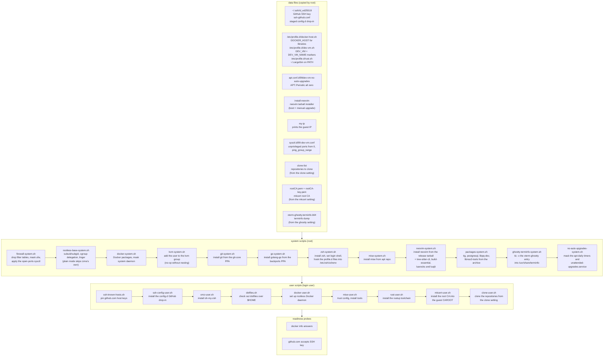

# dev-vm

dev-vm creates isolated Lima dev VMs for macOS. Each VM has:

- its own IP through vzNAT
- no mounts, unless the settings ask for them
- no port forwards
- rootless Docker
- zsh + oh-my-zsh, mise, neovim and Rust
- GitHub SSH access

```sh
go run . create [name]    # create and start the VM
go run . start [name]     # boot a stopped VM
go run . stop [name]      # shut it down, keeping the disk
go run . delete [name]    # delete it (confirms first; -force skips)
go run . disk-resize [name] <GiB>  # grow the disk, keeping the guest
go run . list             # list VMs with status, size, IP and SSH hostname
go run . status [name]    # one VM in detail, including its IP
go run . status [name] -ip  # just the IP, for scripts
go run . completion zsh   # print the shell completion script
go run . version          # print the build version
limactl shell <name>      # open a shell inside
```

For the details of Lima provisioning, read [CLAUDE.md](CLAUDE.md).

## Requirements

- macOS with [Lima](https://lima-vm.io) 2.0.0+ (`limactl`).
- [GitHub CLI](https://cli.github.com) (`gh`), logged in with the
  `admin:public_key` scope. To add the scope, run
  `gh auth refresh -h github.com -s admin:public_key`.
- Go 1.27.1+ (the `go` line in `go.mod`). You need Go to run the CLI with
  `go run .`. A released binary does not need Go.

## Install

### Homebrew

The formula is in the
[robsonpeixoto/homebrew-tap](https://github.com/robsonpeixoto/homebrew-tap)
tap, at `Formula/dev-vm.rb`. Install it from the tap:

```sh
brew tap robsonpeixoto/tap
brew install robsonpeixoto/tap/dev-vm
```

To upgrade later, run `brew update && brew upgrade dev-vm`.

The tap is public, but the release assets of this repo are private. Thus the
formula uses a custom download strategy to get them through the GitHub API.
Credentials come from `HOMEBREW_GITHUB_API_TOKEN`, the `gh` CLI login, or the
macOS keychain, in that order. A logged-in `gh` is sufficient.

### From a release

Every [release](../../releases) has prebuilt binaries attached. The repo is
private, so you need an authenticated `gh` to download them:

```sh
gh release download v0.10.0 -p 'dev-vm_*_darwin_arm64.tar.gz'
tar xzf dev-vm_0.10.0_darwin_arm64.tar.gz
install dev-vm_0.10.0_darwin_arm64/dev-vm /usr/local/bin/dev-vm
```

The binaries are unsigned, so macOS quarantines them when they run for the
first time. To clear the quarantine, run
`xattr -d com.apple.quarantine /usr/local/bin/dev-vm`.

The release also has `linux/{amd64,arm64}` builds. But the tool controls Lima
with `vz`/`vzNAT` (Apple Virtualization.framework), so it works only on macOS.

The binary contains everything that the VM needs. There are no data files to
ship with it. Make sure that a download matches `checksums.txt` from the same
release.

## Usage

1. Create the VM (the default name is `default`):

   ```sh
   go run . create myvm
   ```

   This command generates an SSH key, registers it on GitHub, boots the VM
   (2 vCPUs, 2 GiB RAM, 50 GiB disk) and runs provisioning.

2. Optional: add your dotfiles (a bare repo, checked out over `$HOME`):

   ```sh
   go run . create myvm -dotfiles git@github.com:user/dotfiles.git
   ```

   To use the dotfiles for every VM, put `"dotfiles": "<repo>"` in the
   `default` block of `~/.config/dev-vm/settings.json` (see step 5).
   The `-no-dotfiles` flag skips the dotfiles.

3. Optional: set the size of the VM. The values of `-memory` and `-disk` are
   plain integers in GiB:

   ```sh
   go run . create myvm -cpus 8 -memory 16 -disk 100
   ```

   You can also put the same keys in `~/.config/dev-vm/settings.json`
   (see step 5), as defaults for all VMs on the host. A flag has priority over
   the settings, and the settings have priority over the built-in defaults.
   The size is fixed in the instance at create time. Thus, to change it, you
   must run `go run . delete myvm && go run . create myvm -cpus …`.

4. Optional: turn on nested virtualization, to run VMs inside the dev VM:

   ```sh
   go run . create myvm -nested
   ```

   Nested virtualization needs an Apple M3 or later. Like the size, it is
   fixed at create time (see [nested virtualization](#nested-virtualization)).

5. Optional: write the settings. `~/.config/dev-vm/settings.json` has a
   `default` block that applies to every VM. It also has a `vms` block, keyed
   by VM name. Each VM entry in `vms` overrides the `default` block, key by
   key. These keys add more features:

   - `clone` lists repositories to clone in the guest, per GitHub org, with
     the directory that holds them.
   - `mkcert` copies the host mkcert root CA into the VM.
   - `ghostty` installs the xterm-ghostty terminfo entry in the VM.
   - `nested` gives the guest `/dev/kvm`.
   - `mounts` shares host directories into the guest.

   This example uses all the keys:

   ```json
   {
     "default": {
       "cpus": 8,
       "memory": 16,
       "disk": 100,
       "dotfiles": "git@github.com:user/dotfiles.git",
       "mkcert": true,
       "ghostty": true,
       "nested": false,
       "clone": [
         {
           "org": "robsonpeixoto",
           "basedir": "${HOME}/Code/robsonpeixoto",
           "repositories": ["dev-vm", "echo-server"]
         }
       ],
       "mounts": [
         {"source": "~/Downloads", "destination": "~/Downloads", "mode": "ro"}
       ]
     },
     "vms": {
       "new-vm": {
         "cpus": 4,
         "memory": 4,
         "clone": [],
         "mkcert": false,
         "ghostty": false,
         "mounts": []
       }
     }
   }
   ```

   In this example, `new-vm` gets 4 vCPUs and 4 GiB. It keeps the default
   100 GiB disk and the default dotfiles. It clones nothing, mounts nothing,
   and gets neither the CA nor the terminfo entry. Every other VM gets the
   `default` block as written.

   An override replaces the full value of the key. It does not merge into
   that value. Thus `"clone": []` means no repositories, and `"dotfiles": ""`
   means no dotfiles. dev-vm rejects unknown keys at the two levels.

   `basedir` is a guest path. `${HOME}` (or `$HOME`) in it expands in the
   guest. The last user provisioning step clones each repository over SSH, as
   `git@github.com:<org>/<repo>.git`, into `<basedir>/<repo>`. At that point,
   the provisioned key and `known_hosts` are already in place. The step skips
   a repository whose directory already exists. If a clone fails (no access,
   wrong name), the step logs the failure and skips that repository too.

   Neither case stops the other repositories. Boot provisioning runs the step
   again on every start. Thus it also clones repositories that you add to the
   setting later.

   `"mkcert": true` needs [mkcert](https://github.com/FiloSottile/mkcert) on
   the host, with a CA generated already (`mkcert -install`). If this is not
   the case, `create` fails with a hint (see [mkcert root CA](#mkcert-root-ca)).

   `"ghostty": true` needs ncurses from Homebrew on the host
   (`brew install ncurses`, see [ghostty terminfo](#ghostty-terminfo)).

   `mounts` entries take a host `source`, a guest `destination` and a
   `mode` (see [host mounts](#host-mounts)).

   `"nested": true` needs an Apple M3 or later (see
   [nested virtualization](#nested-virtualization)).

6. Open a shell in the VM:

   ```sh
   limactl shell myvm
   # or, with the hostname from the SSH column of `go run . list`:
   ssh -F ~/.lima/myvm/ssh.config lima-myvm
   ```

7. List the VMs. The list shows the name, Lima status, size, guest IP and SSH
   hostname of each VM:

   ```sh
   go run . list
   ```

   ```
   NAME    STATUS   CPUS  MEM   DISK   IP              SSH
   myvm    Running  4     8GiB  50GiB  192.168.64.26   lima-myvm
   ```

   The `IP` value comes from the guest, because the IP exists only there.
   Thus a VM that is not running shows `-`. There are no port forwards. To
   reach anything that the VM serves, use that IP:

   ```sh
   curl http://192.168.64.26:3000
   ```

8. Show one VM in detail. The output has the same fields, plus the dotfiles
   repo, the key path and the creation time. The default name is `default`:

   ```sh
   go run . status myvm
   ```

   For scripts, use `-ip` to print only the guest IP:

   ```sh
   curl "http://$(go run . status myvm -ip):3000"
   ```

   If the VM is not running, or does not answer in the 5 s deadline, the
   command prints an empty line and exits 0.

9. Stop the VM, or start it again. After a host reboot, every VM is stopped.
   `start` boots the VM again. It also runs provisioning and the readiness
   probes again:

   ```sh
   go run . stop myvm
   go run . start myvm
   ```

   `stop -force` kills the VM. It does not do a clean shutdown of the guest.
   This is faster, but the guest loses the data that it did not write yet.

10. Delete the VM. This command deletes the VM, the GitHub key and the local
   key pair. It shows a prompt first. To continue, type the VM name. Any
   other input cancels the deletion:

   ```sh
   go run . delete myvm
   ```

   Scripts and CI use `-force` to skip the prompt. If stdin is not a terminal,
   `delete` refuses and does not hang. Thus `-force` is mandatory in that
   case:

   ```sh
   go run . delete myvm -force
   ```

   `delete` checks the token scope before the prompt. It deletes the VM disk
   last, after the GitHub key and the local pair. Thus, after a `gh` failure
   (logged out, expired token, offline), the VM is still usable.

dev-vm keeps its state in `~/.config/dev-vm/state.json` and its keys in
`~/.config/dev-vm/keys/`.

## Networking

Every VM has its own IP on the `vzNAT` interface. That IP is the only way into
the VM. These rules apply:

- **No port forwarding, ever.** `portForwards` in `lima/dev-vm.yaml` ignores
  both `127.0.0.1` and `0.0.0.0`. Clients reach a guest service at the guest
  IP and the port of that service. They never reach it at a forwarded port on
  the host.
- **No firewall in the guest.** `lima/scripts/firewall-system.sh` runs first
  on every boot. It deletes the `inet/ip/ip6 filter` tables. Then it disables,
  stops and masks `ufw.service`, so a package upgrade or a dotfiles checkout
  cannot turn a firewall on again. The script does not touch Lima's own
  `table ip nat`. Its `LIMADNS` chains redirect guest DNS, and a blanket
  `nft flush ruleset` breaks name resolution.
- **Every port is usable, including below 1024.** The guest sets
  `net.ipv4.ip_unprivileged_port_start=0`
  (`/etc/sysctl.d/99-dev-vm.conf`). Thus rootless Docker can publish ports 80
  and 443:

  ```sh
  limactl shell myvm docker run -d -p 80:80 nginx
  curl "http://$(go run . status myvm -ip)/"
  ```

- **The IP comes from the guest.** Lima does not report it.
  `limactl list --format json` contains only the MAC, and the macOS DHCP lease
  file keeps stale rows. Thus `list` and `status` run
  `limactl shell <name> ip -4 -json addr show lima0`. They run it once per
  running VM, in parallel, with a 5 s deadline. If a VM is stopped or slow to
  answer, it shows `-`, and the command does not fail.
- **From inside the guest**, `my-ip` (`/usr/local/bin/my-ip`) prints the same
  address. It reads `lima0`. As a fallback, it reads the interface that
  carries the default route.
- The IP is a DHCP lease, so it can change when the VM reboots. Do not
  hardcode it. Read it from `go run . list` or `go run . status <name>`.

`limactl shell` and the generated `~/.lima/<name>/ssh.config` still use Lima's
own ssh tunnel on `127.0.0.1`. That tunnel is internal to Lima. It is not a
`portForwards` entry.

### Publishing ports

Rootless Docker publishes ports through RootlessKit. The pair of drivers that
RootlessKit uses decides which publish forms work. This VM uses the
`slirp4netns` network driver with the `builtin` port driver. That is the only
combination where all of these forms work:

```sh
docker run -d -p 8080:80 nginx          # every interface
docker run -d -p 80:80 nginx            # below 1024
docker run -d -p "$(my-ip)":8080:80 nginx   # the guest's own vzNAT IP
```

The last form is the reason that the driver pair is important. `pasta` is the
faster network driver. But with `pasta`, RootlessKit accepts only the
`implicit`, `none` or `pesto` port drivers. With `implicit`, the ports bind
inside a namespace that has only one address: `10.0.2.100`, the address of
pasta. Thus a publish on the guest IP fails:

```
failed to bind host port 192.168.64.12:8081/tcp: cannot assign requested address
```

`pesto` removes that limit, but it needs `passt >= 2026_05_07`. Ubuntu 26.04
ships an older version. `builtin` binds in the network namespace of the guest
itself. The cost is a userspace copy for each connection.

**Nothing configures this.** When `slirp4netns` is on `PATH`,
`dockerd-rootless.sh` selects exactly that pair. Thus the full setup is one
package in the list of `docker-system.sh`. This repo has no systemd drop-in
and no `DOCKERD_ROOTLESS_ROOTLESSKIT_*` variable.

The package is separate on purpose. `docker-ce-rootless-extras` ships
`rootlesskit`, but not the `slirp4netns` binary. Without that binary, the
daemon uses pasta as a fallback, and the failure above occurs.

To reach a published port from the host, always use the guest IP:
`curl "http://$(go run . status myvm -ip):8080/"`. There are no port forwards,
so `localhost:8080` on the host never answers.

## Shell completion

`dev-vm completion <bash|zsh|fish>` prints the completion script for that
shell. The script completes subcommands, the `create`, `stop` and `delete`
flags, and the recorded VM names for `start`, `stop` and `delete`.

To use it in the current shell, run one of these commands:

```sh
source <(dev-vm completion bash)
source <(dev-vm completion zsh)
dev-vm completion fish | source
```

Homebrew installs the three scripts, so `brew install dev-vm` needs no extra
step. If you do not use Homebrew, install one script permanently:

```sh
dev-vm completion bash > /usr/local/etc/bash_completion.d/dev-vm
dev-vm completion zsh > "${fpath[1]}/_dev-vm"
dev-vm completion fish > ~/.config/fish/completions/dev-vm.fish
```

The release tarballs also contain the scripts in `completions/`.

The zsh script needs `compinit` to run before it. The VM names come from the
hidden `dev-vm __names` command. That command prints the VMs in the state
file.

## Releasing

`.github/workflows/ci.yml` runs on every push to `main` and on every pull
request. It runs `make check-format-go`, `go vet`, `go build` and `go test`.
A parallel `shell` job covers every shell file in the repo. That job runs
`shellcheck` on `lima/scripts/*.sh`, `lima/files/*.sh`,
`lima/files/install-neovim` and `completions/dev-vm.bash` (shellcheck does not
support the zsh and fish dialects). Then it runs `make check-format-shell`.

The `Makefile` holds the code style, so CI and a local run cannot differ:

```sh
make format         # gofmt -w, shfmt -w
make check-format   # the same, diff-only; what CI runs
```

`format-go`/`format-shell` and `check-format-go`/`check-format-shell` are the
two halves, one for each CI job. `SHELL_DIRS` names the directories that shfmt
walks (`lima` and `completions`). shfmt finds shell files there by extension
or shebang. Thus it also covers a new script, with no change to the
`Makefile`. shfmt gets the 4-space indent from the `[[shell]]` section of
`.editorconfig` at the repo root.

When you push a `v*` tag, `.github/workflows/release.yml` runs. The workflow
does these steps:

- It cross-compiles `linux/{amd64,arm64}` and `darwin/{amd64,arm64}`.
- It injects the tag into `main.version` with `-ldflags -X`.
- It publishes the four tarballs (each with `README.md` and `completions/`)
  and `checksums.txt` on a GitHub Release with generated notes.

To make a release, run these commands:

```sh
git tag -a v0.10.0 -m v0.10.0
git push origin v0.10.0
```

A last job checks out
[robsonpeixoto/homebrew-tap](https://github.com/robsonpeixoto/homebrew-tap).
It updates `version` and the four `sha256` values in its `Formula/dev-vm.rb`
from `checksums.txt`. Then it pushes the change. Thus the tap serves the new
release, and nobody edits the formula manually. This job has two
requirements:

- The repository secret `HOMEBREW_TAP_TOKEN` must hold a PAT with
  `contents: write` on the tap repo. `github.token` gives access only to this
  repository.
- In the formula, each `sha256` line must stay two lines below its `url` line.
  If it does not, the job fails with a clear error.

## GitHub SSH key

`create` generates a new ed25519 key pair each time that it runs. It never
uses a key from `~/.ssh`. It registers the public key on GitHub with the title
`dev-vm/<host>/<name>`. This replaces any earlier key with the same title.
`-create-ssh-key=false` reuses the pair from an earlier create.

`<host>` is the short host name from `os.Hostname()` (no `.local` suffix).
Thus, if two machines both create `default`, they register two different keys.
They do not delete the key of the other machine. The state file records the
exact title as `github_key_title`. `delete` deletes the key with that stored
title. For VMs created before titles were qualified, it uses the bare VM name
as a fallback.

- Host: `~/.config/dev-vm/keys/<name>` (directory 0700, private key 0600).
  Every create enforces these modes. dev-vm never reads `~/.ssh` on the host.
  Lima does not load `~/.ssh/*.pub` into the guest.
- Guest: provisioning uploads the private key to `~/.ssh/id_ed25519`. It
  installs the stanza that pins this key for github.com with
  `IdentitiesOnly yes` as `~/.ssh/config.d/10-github.conf`.
- **This repo never writes `~/.ssh/config`.** It is the job of the dotfiles to
  load the drop-ins. The `~/.ssh/config` of the dotfiles repo must contain
  `Include ~/.ssh/config.d/*.conf`, near the top. ssh keeps the first value
  that it sees for a keyword.

  Without that line, the drop-in has no effect. Git over SSH still works,
  because ssh tries `~/.ssh/id_ed25519` by default. But `IdentitiesOnly yes`
  is not in effect. Thus ssh can offer an agent or extra key from the
  dotfiles to GitHub first.
- `delete` deletes the GitHub key, the local pair, the VM and the state
  entry, in that order. It starts after you type the VM name at the prompt.
  `-force` skips the prompt. The irreversible step is last, and `delete` checks the token
  scope first. Thus a `gh` failure stops the command while the VM still
  exists.

## mkcert root CA

If the settings contain `"mkcert": true` (see step 5 of [usage](#usage)),
`create` reads `mkcert -CAROOT` on the host. Then it gives the VM the same
certificate authority. Thus the host browser trusts a certificate issued in
the guest, and the guest trusts a certificate issued on the host.

- Provisioning copies `rootCA.pem` **and** `rootCA-key.pem` into the guest
  CAROOT. The guest CAROOT is `~/.local/share/mkcert`, unless `CAROOT` or
  `XDG_DATA_HOME` gives a different path. The key comes along on purpose.
  Without the key, the guest can only trust the CA. It cannot issue
  certificates from it (`mkcert app.test`).
- `rootCA.pem` also goes into `caCerts.files` in the template. That field
  gives the file to cloud-init. cloud-init puts it in
  `/usr/local/share/ca-certificates`, and `update-ca-certificates` trusts it
  system-wide. Thus `curl` and every library that uses the system store
  accept guest-issued certificates with no extra flag.
- The `caCerts.files` entry in `~/.lima/<name>/lima.yaml` is the **host**
  path. Lima reads it again on every start, because it regenerates
  `cidata.iso` from `lima.yaml` each time. If you delete or move the host
  CAROOT, `go run . start <name>` fails for that VM. It fails until the file
  is back, or until you delete the entry with `limactl edit <name>`.
- Nothing runs `mkcert -install` in the guest. The `caCerts` field above
  covers the system store. A guest browser has its own NSS store, and trust
  there needs a manual `mkcert -install`. `libnss3-tools` is already
  installed.
- This repo does not install mkcert itself. mkcert comes from mise or the
  dotfiles. Provisioning copies the CA files in both cases.
- `create` reads the setting at create time, like everything else. Thus, to
  turn it on later, you must delete the VM and create it again.

## Rust toolchain

`rust-user.sh` installs [rustup](https://rustup.rs) as the guest login user,
with `--profile minimal` and the stable toolchain. Thus `cargo` and `rustc`
are available for the neovim plugins that ship a Rust component. The main one
is [blink.cmp](https://github.com/saghen/blink.cmp). Its
`require('blink.cmp').build()` runs `cargo build --release` on the fuzzy
matcher of the plugin.

- Per user, not an apt package. rustup owns `~/.rustup` and `~/.cargo`. Thus
  `rustup update`, `rustup component add` and `cargo install` work without
  sudo. This repo intentionally does *not* install `cargo` from the Ubuntu
  archive. Crates raise their minimum Rust version much faster than an LTS
  archive moves. Also, two toolchains on one `PATH` are worse than one.
- `PATH` comes from `/etc/profile.d/rust.sh`. Thus rustup runs with
  `--no-modify-path` and appends nothing to `~/.zshrc` or `~/.profile`, which
  the dotfiles own. `zsh-system.sh` also makes `/etc/zsh/zshenv` load that
  file. Thus non-login shells, and any nvim started from one, find `cargo`.
- The other inputs of a `cargo build` are already in the guest. `git` comes
  from `git-system.sh` (the `build.rs` of blink.cmp runs
  `git rev-parse HEAD`). The linker comes from `build-essential` in
  `neovim-system.sh`. blink.cmp also needs Neovim 0.12+, and the release
  tarball provides it (see [provisioning steps](#provisioning-steps)).
- `--profile minimal` means no `clippy`, `rustfmt` or `rust-docs`. To add the
  components that you need, run `rustup component add clippy rustfmt`.
- Boot provisioning never upgrades an existing toolchain. If
  `~/.cargo/bin/cargo` exists, the script skips its work. To upgrade, run
  `rustup update`.

## ghostty terminfo

If the settings contain `"ghostty": true`, `create` dumps the `xterm-ghostty`
terminfo entry on the host. Then the guest compiles it. Thus the `TERM` that
[Ghostty](https://ghostty.org) exports continues to work inside the VM.
Without the entry, ncurses programs use the `xterm-256color` fallback, or
complain that the terminal is unknown.

- The dump uses the `infocmp` from **Homebrew**
  (`$(brew --prefix ncurses)/bin/infocmp -x xterm-ghostty`). The built-in
  macOS version is ncurses 6.0 from 2015. It corrupts the extended (`-x`)
  capabilities, which are most of the entry. Thus `brew install ncurses` is a
  requirement, not a preference. If the binary is not there, `create` fails
  with that hint.
- The entry itself comes from the location in `TERMINFO`. When `devvm` runs
  inside Ghostty, that location is the app bundle. Outside Ghostty, `create`
  tries again with
  `TERMINFO=/Applications/Ghostty.app/Contents/Resources/terminfo`.
- `create` stages the dump base64-encoded. `ghostty-terminfo-system.sh` sends
  it through `tic -x -o /usr/share/terminfo`, as root. The result is
  system-wide, so `sudo` and root shells also get the entry. The base64
  encoding is not decoration. [CLAUDE.md](CLAUDE.md) explains how Lima applies
  its templates to `mode: data` content.
- Nothing sets `TERM` in the guest. ssh and `limactl shell` carry the host
  value. That is the reason to compile the entry in the guest.
- Like every other setting, `create` reads this one at create time. Thus, to
  turn it on later, you must delete the VM and create it again.

## Host mounts

Each entry of the `mounts` setting (see step 5 of [usage](#usage)) shares one
host directory into the guest through Lima's own mounts (virtiofs under vz):

| Key | Required | Meaning |
|---|---|---|
| `source` | yes | Host directory: an absolute path, `~` or `~/...` (the host home) |
| `destination` | no | Guest path: absolute, `~` or `~/...` (the **guest** home, `/home/<user>.linux`). The default is `source` as expanded on the host, for example `/Users/<user>/Code` |
| `mode` | no | `"ro"` (default) or `"rw"` |

```json
{"default": {"mounts": [
  {"source": "~/Code", "destination": "~/host-code", "mode": "rw"},
  {"source": "/Volumes/data"}
]}}
```

- `create` rejects a relative path, `~user`, an unknown `mode`, and paths that
  contain quotes, backslashes, braces or control characters. Lima itself
  rejects system destinations, for example `/etc`, `/usr` or `/home`.
- Like the size, mounts are fixed at create time. The list goes into the
  `lima.yaml` of the instance. To change the mounts, use
  `limactl edit <name>`, or delete the VM and create it again.
- With a `"rw"` mount, anything in the VM can write to the host directory.
  This includes every container that you run with access to the directory.
  Thus the VM is no longer an isolation boundary for that path. Keep mounts
  narrow. Unless the VM must write to a mount, make it read-only.

## Nested virtualization

`go run . create myvm -nested` (or `"nested": true` in the settings) sets the
Lima `nestedVirtualization` field on the instance. Thus the guest can run its
own VMs. Examples are a QEMU/KVM guest, or a Linux Lima instance to work on
this repo from inside the dev VM.

```sh
go run . create myvm -nested
limactl shell myvm -- ls -l /dev/kvm
# crw-rw---- 1 root kvm 10, 232 /dev/kvm
```

- **Apple M3 or later**, with `vmType: vz`. `create` reads
  `machdep.cpu.brand_string` and refuses earlier Apple silicon (and Intel).
  It does this before it registers a GitHub key, so the VM does not fail at
  start.
- The flag has priority over the setting in both directions. `-nested` turns
  nesting on for a VM that the settings leave off. `-nested=false` turns it
  off for a VM that the `default` block turns on.
- Nesting is fixed at create time, like the size. When Lima creates the
  instance, it flattens the template into `~/.lima/<name>/lima.yaml`. To
  change nesting, use `limactl edit <name>`, or delete the VM and create it
  again.
- Without nesting, the guest kernel sees no virtualization extensions and
  creates no `/dev/kvm`. For this reason, `kvm-system.sh` is a no-op on such
  a VM.
- `/dev/kvm` is `root:kvm` 0660, and the image does not put the login user in
  that group. `kvm-system.sh` adds the user to the group on every boot. Group
  membership applies at the next login. The next `limactl shell` is already
  that next login.
- Nothing installs QEMU, libvirt or Lima in the guest. The operator runs
  `apt-get install qemu-system-arm`, as the policy in
  [upgrading the guest](#upgrading-the-guest) requires. A note from Lima
  applies: a nested QEMU needs `-cpu host`, for example
  `qemu-system-aarch64 -accel kvm -cpu host -M virt`.

## Guest OS

`base: [template:_images/ubuntu-26.04]` in `lima/dev-vm.yaml` pins the guest
to **Ubuntu 26.04 LTS**.

The pin is intentional. `template:_images/ubuntu-lts` is a symlink inside the
installed Lima release, so it changes with that release. A Lima upgrade can
move new VMs to the next LTS, with no change in this repo. Also, two identical
`create` runs on different days can make different guests. The per-release
names are stable. Lima keeps one name for every LTS that it shipped
(`ubuntu-20.04`, `ubuntu-22.04`, `ubuntu-24.04`, `ubuntu-26.04`).

A bump never changes existing VMs. Lima flattens the template at create time,
so the release is fixed for the life of an instance. Only VMs created after
the bump get the new release.

### Bumping to a new LTS

Ubuntu ships an LTS every two years. Lima adds the template at about the
release day. Bump the pin only after these two conditions are true:

- The Lima version that you run has the template.
- The Docker apt repo has the new codename.

`docker-system.sh` gets the codename from `/etc/os-release` in the guest.
Docker publishes one suite for each codename. Thus a bump that is too early
makes provisioning fail at `apt-get update`. (The mise repo does not depend on
the codename.)

1. Make sure that the template exists. Then find the current target of
   `ubuntu-lts`:

   ```sh
   ls "$(brew --prefix lima)/share/lima/templates/_images" | grep ubuntu
   grep -m1 location "$(brew --prefix lima)/share/lima/templates/_images/ubuntu-lts.yaml"
   ```

2. Set the `base:` entry in `lima/dev-vm.yaml` to the new
   `template:_images/ubuntu-XX.YY`. Then update the release name in this
   section and in [CLAUDE.md](CLAUDE.md).
3. Create a temporary VM. Do each check in the list below on that VM. Then
   delete the VM:

   ```sh
   go run . create pinbump
   go run . delete pinbump
   ```

Every new LTS must pass all three checks on that new VM:

- **Boot** — `create` finishes without a provisioning error, and
  `limactl shell pinbump sudo cat /var/log/cloud-init-output.log` shows no
  failed script.
- **Docker probe** — the rootless-Docker readiness probe passes. To make sure
  that it passes, run `limactl shell pinbump docker info`.
- **GitHub probe** — the SSH probe passes. To make sure that it passes, run
  `limactl shell pinbump ssh -T git@github.com`. The output must contain
  `successfully authenticated`.

## Upgrading the guest

**Nothing upgrades itself.** The VM installs what it needs on the first boot,
and then it does not change. It has no cron, no `unattended-upgrades` and no
apt-daily timers. If a workspace changes versions by itself, you cannot find
the date when it broke. Also, a patch at the same time as boot provisioning
causes a race for the dpkg lock.

Two parts enforce this rule. Provisioning applies both of them on every boot:

- `/etc/apt/apt.conf.d/99dev-vm-no-auto-upgrades` sets every `APT::Periodic`
  key to `0`. apt reads it after the packaged `20auto-upgrades`.
- `no-auto-upgrades-system.sh` **masks** `apt-daily.timer`,
  `apt-daily-upgrade.timer`, their services and `unattended-upgrades.service`.
  The units are masked, not disabled. A package upgrade can enable a disabled
  unit again. Nothing can start a masked unit, even while it is enabled.

An upgrade is an intentional command. One apt call upgrades everything that
apt installed: the OS, Docker, git (git-core PPA), Go (longsleep PPA), mise,
zsh and the neovim build toolchain. Rust does not come from apt (see below).
To upgrade the apt packages, run these commands:

```sh
limactl shell <name> sudo apt-get update
limactl shell <name> sudo apt-get upgrade
```

neovim is not an apt package. It comes from the official release tarball, so
it has its own installer. Boot provisioning runs the same installer. The
installer finds the latest release and compares it with the installed binary.
If they match, it does nothing. To upgrade neovim, run this command:

```sh
limactl shell <name> sudo /usr/local/lib/dev-vm/install-neovim
```

Rust is neither of these. rustup owns it, for each user. Boot provisioning
does not change an existing toolchain (see [Rust toolchain](#rust-toolchain)).
To upgrade Rust, run this command:

```sh
limactl shell <name> rustup update
```

A kernel upgrade takes effect at the next restart
(`go run . stop <name> && go run . start <name>`). To make sure that nothing
runs on a schedule without your knowledge, run these commands:

```sh
limactl shell <name> systemctl is-enabled apt-daily.timer apt-daily-upgrade.timer
limactl shell <name> ls /etc/cron.d
```

The VM is cheap to replace. Thus the other upgrade path is
`go run . delete <name> && go run . create <name>`. A new create installs the
current version of everything.

## Disk hygiene

The default disk size is 50 GiB. Docker images and the build cache fill it.
No cron runs in this VM, so nothing prunes them on a schedule. When the disk
is almost full, run this command to get space back:

```sh
limactl shell <name> docker system prune -af --filter "until=168h"
```

- The command deletes stopped containers, unused images, unused networks and
  build cache older than a week. Without `--volumes`, it **never touches
  volumes**, so database and cache data stays.
- `until` filters on the *creation* time, not on the last use. Thus the first
  run deletes an unused base image built months ago. Anything that a running
  container uses stays.
- To delete everything unused, run the command without the filter
  (`docker system prune -af`). To delete only the build cache, run
  `docker builder prune -af`.

Lima reports the disk *size*, not its usage. Thus `go run . list` cannot show
how full the disk is. To see the usage, run these commands in the guest:

```sh
limactl shell <name> docker system df     # -v for a per-image breakdown
limactl shell <name> df -h /
```

A resize is the difficult part. `cpus`, `memory` and `disk` are fixed in
`~/.lima/<name>/lima.yaml` at create time. Select the size before you create
the VM, with `go run . create myvm -disk 100`. For every VM, you can use the
`disk` key of the `default` block in `~/.config/dev-vm/settings.json`. For one
VM, you can use the `disk` key of a `vms` block. Later, you can grow the disk
alone, and keep the guest:

```sh
go run . disk-resize myvm 100
```

- The command stops a running VM, runs `limactl edit myvm --disk 100`, and
  starts the VM again. A stopped VM stays stopped, and its disk grows on its
  next start.
- Lima grows a disk but never shrinks it. Thus the command refuses a smaller
  size before it touches the VM.
- The command writes `"disk": 100` into the `vms.myvm` block of
  `settings.json`. If the file does not exist, the command creates it. Thus a
  later delete and create keeps the size. The blocks that it edits (the root,
  `vms` and `vms.myvm`) get their keys sorted. Every other block keeps its
  order.

CPUs and memory have no such command. To change them, use
`limactl stop <name>` and then `limactl edit <name>`. Alternatively, use
`go run . delete myvm && go run . create myvm`, but this deletes the guest.

## Provisioning steps

Every step runs on **each boot** (all scripts are idempotent). When everything
is in place, the install scripts skip their apt and download work. Thus only
the first boot uses the network, and restarts stay fast. Nothing here upgrades
anything (see [upgrading the guest](#upgrading-the-guest)). Lima flattens the
template at create time. Thus, after a change to `lima/dev-vm.yaml` or
`lima/scripts/*.sh`, you must recreate the VM.

The order is: data files, then system scripts (root), then user scripts (guest
login user). Then the readiness probes gate `limactl start`.

1. **Data files** — provisioning copies these files:
   - the GitHub key + ssh config
   - the global `DOCKER_HOST` snippet (`/etc/profile.d/docker-host.sh`)
   - the `DEV_VM`/`DEV_VM_NAME` markers (`/etc/profile.d/dev-vm.sh`)
   - the rustup PATH entry (`/etc/profile.d/rust.sh`)
   - the no-auto-upgrade policy in
     `/etc/apt/apt.conf.d/99dev-vm-no-auto-upgrades`
   - the sysctls (`/etc/sysctl.d/99-dev-vm.conf`): unprivileged ports from 0
     and `net.ipv4.ping_group_range`. Plain mode stops Lima from setting
     these two itself.
   - the neovim installer (`/usr/local/lib/dev-vm/install-neovim`).
     `neovim-system.sh` runs it, and the operator runs it again to upgrade.
   - the `my-ip` helper (`/usr/local/bin/my-ip`). It prints the guest IP from
     inside the VM.
   - the repository list that `clone-user.sh` reads
     (`/usr/local/lib/dev-vm/clone-list`). `devvm create` writes it from the
     `clone` setting.
   - the mkcert root CA pair (`/usr/local/lib/dev-vm/rootCA.pem` and
     `rootCA-key.pem`). Both files are empty unless the `mkcert` setting is
     on.
   - the base64 `xterm-ghostty` terminfo dump
     (`/usr/local/lib/dev-vm/xterm-ghostty.terminfo.b64`). It is empty unless
     the `ghostty` setting is on.
2. **`firewall-system.sh`** — keeps the guest network open, and runs first of
   the system scripts. It installs `nftables` if it is missing, and deletes
   the `inet/ip/ip6 filter` tables. It never runs `nft flush ruleset`, because
   Lima's `table ip nat` carries the `LIMADNS` chains. Then it disables, stops
   and masks `ufw.service`, and runs `sysctl --system` to apply
   `net.ipv4.ip_unprivileged_port_start=0`. Rootless Docker keeps its own
   rules in its user network namespace, and the script does not touch them
   (see [networking](#networking)).
3. **`rootless-base-system.sh`** — restores the rootless prerequisites that
   plain mode drops. Lima's `boot.sh` runs `boot.essential.Linux/*` and then
   skips every `boot.Linux/*` script, including
   `boot.Linux/20-rootless-base.sh`. Thus this script does that work:
   - It adds the `/etc/subuid` and `/etc/subgid` ranges of the guest user.
     Without them, `dockerd-rootless-setuptool.sh` fails with
     `could not find <user> in /etc/subuid`.
   - It puts `Delegate=yes` into `/etc/systemd/system/user@.service.d/`.
   - It starts `systemd-logind`.
   - It enables linger for the user, so the systemd user instance of the
     daemon survives logout.
4. **`docker-system.sh`** — if any part of Docker Engine is missing, installs
   it from the Docker apt repo, with `docker-ce-rootless-extras` and
   `slirp4netns`. Then it masks the system-wide `docker`/`containerd` units,
   so only the rootless daemon exists.
5. **`kvm-system.sh`** — if `/dev/kvm` exists, puts the login user in the
   `kvm` group. Thus a nested guest is reachable without sudo. On a VM created
   without nesting, it is a no-op (see
   [nested virtualization](#nested-virtualization)).
6. **`git-system.sh`** — if the PPA or git is missing, installs git from the
   git-core PPA (`ppa:git-core/ppa`, upstream releases).
7. **`go-system.sh`** — if the PPA or the package is missing, installs
   `golang-go` from the golang-backports PPA
   (`ppa:longsleep/golang-backports`, current upstream Go).
8. **`zsh-system.sh`** — if zsh is missing, installs it. It runs `chsh` to
   make zsh the shell of the guest user. It also makes `/etc/zsh/zshenv`
   source `/etc/profile.d/docker-host.sh`, `/etc/profile.d/dev-vm.sh` and
   `/etc/profile.d/rust.sh`. Thus a non-login zsh
   (`limactl shell <name> <cmd>`) also gets `DOCKER_HOST`, `DEV_VM`,
   `DEV_VM_NAME` and `~/.cargo/bin` on `PATH`.
9. **`mise-system.sh`** — if mise is missing, installs it from its apt repo.
10. **`neovim-system.sh`** — if any part is missing, installs `curl` and the
   plugin build toolchain that the tarball does not ship. That toolchain is
   `tree-sitter-cli` and `build-essential` for `nvim-treesitter` parsers, and
   `luarocks` with `luajit` for Lua rocks. Then, only if `/usr/local/bin/nvim`
   is absent, it runs `/usr/local/lib/dev-vm/install-neovim`. The installer
   unpacks the official pre-built archive into `/opt/nvim-linux-<arch>`
   (`x86_64` or `arm64`, from `uname -m`) and links it at
   `/usr/local/bin/nvim`. The same installer is also the upgrade path, so the
   first boot and a later `sudo /usr/local/lib/dev-vm/install-neovim` share
   one code path.
10. **`packages-system.sh`** — installs the rest of the toolchain from the
   Ubuntu archive. These are the packages that need no third-party repo:
   `tig`, `postgresql` with `libpq-dev`, and `libnss3-tools` (`certutil`, to
   trust a local CA). If all of them are installed, the script skips all its
   work.
11. **`ghostty-terminfo-system.sh`** — decodes the staged `xterm-ghostty`
   terminfo dump and compiles it with `tic -x` into `/usr/share/terminfo`. If
   the image has no `tic`, it installs `ncurses-bin` first. If the staged file
   is empty, the script is a no-op (see [ghostty terminfo](#ghostty-terminfo)).
12. **`no-auto-upgrades-system.sh`** — masks `apt-daily.timer`,
   `apt-daily-upgrade.timer`, their services and `unattended-upgrades.service`.
   Thus the stock automatic upgrades of Ubuntu never start. The matching
   `APT::Periodic` zeros come in the data file above (see
   [upgrading the guest](#upgrading-the-guest)).
13. **`ssh-known-hosts.sh`** — writes `~/.ssh/known_hosts` again from live
   `ssh-keyscan github.com` output.
14. **`ssh-config-user.sh`** — creates `~/.ssh/config.d` and installs the
   staged GitHub stanza as `10-github.conf`. It does not touch
   `~/.ssh/config` (see [GitHub SSH key](#github-ssh-key)).
15. **`omz-user.sh`** — installs oh-my-zsh. If `~/.oh-my-zsh` exists, it skips
   the install.
16. **`dotfiles.sh`** — clones the bare repo to `~/.dotfiles` and checks it out
   over `$HOME`. Files that the checkout overwrites move to
   `~/tmp/config-backup`. Without `DOTFILES_REPO`, it is a no-op. The repo
   owns `~/.ssh/config`, so it also has the job to include the drop-ins above.
17. **`docker-user.sh`** — runs `dockerd-rootless-setuptool.sh install`, then
   selects the `rootless` context. It does not configure the network. The
   daemon uses `slirp4netns` + the `builtin` port driver by default, because
   `docker-system.sh` installed the `slirp4netns` package (see
   [publishing ports](#publishing-ports)).
18. **`mise-user.sh`** — activates mise in `~/.zshrc`, unless the oh-my-zsh
   mise plugin already does it. Then it runs `mise trust --all` and
   `mise install`.
19. **`rust-user.sh`** — installs the Rust toolchain with rustup
   (`--profile minimal`, stable), unless `~/.cargo/bin/cargo` is already
   there (see [Rust toolchain](#rust-toolchain)).
20. **`mkcert-user.sh`** — installs the staged root CA pair into the guest
   CAROOT. That is `~/.local/share/mkcert`, unless `CAROOT`/`XDG_DATA_HOME`
   gives a different path. It runs after mise, so `mkcert -CAROOT` can give
   the path itself. If the staged files are empty, it is a no-op (see
   [mkcert root CA](#mkcert-root-ca)).
21. **`clone-user.sh`** — clones the repositories from the `clone` setting into
   `<basedir>/<repo>`. It runs last, so the ssh key, `known_hosts` and git are
   all in place. `${HOME}` in `basedir` expands here, in the guest. The script
   skips an existing directory. It logs a failed clone and skips it. Neither
   case stops the other repositories.


